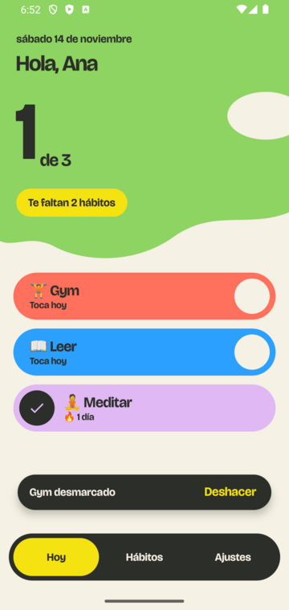
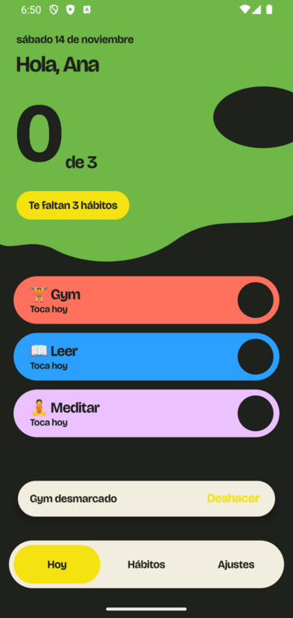
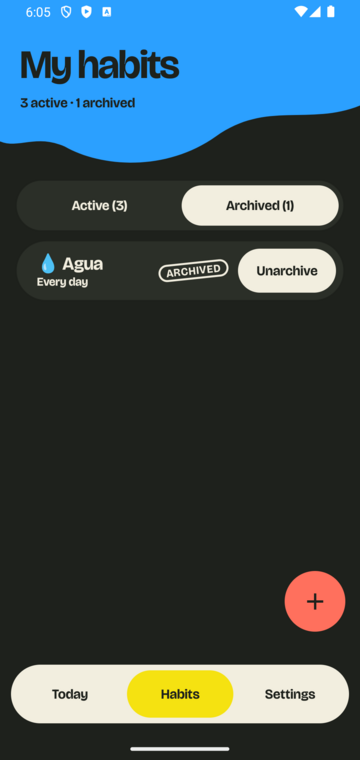

# Habit Tracker

App móvil para crear hábitos diarios, marcarlos cada día y ver tus rachas. Funciona en **Android e iOS** con un solo código compartido (Compose Multiplatform).

Es privada: todo se guarda en el teléfono, protegido con un PIN de 4 dígitos. No hay servidor, nube ni anuncios.

<p>
  
  
  
</p>

## Qué hace

- **Registro y PIN**: cuenta local con nombre, correo y PIN; pregunta de seguridad para recuperarlo.
- **Hábitos**: crear, editar, archivar y desarchivar, con emoji, color y días de la semana.
- **Hoy**: marcar con un toque, deshacer, racha 🔥 por hábito y marcar lo pendiente de ayer.
- **Ajustes**: idioma (español / inglés), tema (claro / oscuro / del teléfono) y cambio de PIN.

## Stack

| Área | Tecnología |
|---|---|
| Lenguaje | Kotlin 2.4 |
| UI | Compose Multiplatform 1.12 + Material 3 |
| Arquitectura | MVVM (ViewModel + StateFlow), capas `domain` / `data` / `ui` |
| Navegación | Navigation Compose (rutas tipadas) |
| Base de datos | Room 2.8 (KMP) sobre SQLite |
| Preferencias | DataStore |
| Inyección de dependencias | Koin 4 |
| Fechas | kotlinx-datetime |
| Seguridad | PIN y respuesta de seguridad con hash PBKDF2 (cryptography-kotlin) |
| Pruebas | kotlin.test, coroutines-test, Turbine · E2E con Maestro |
| Build | Gradle (Kotlin DSL) + catálogo de versiones, AGP 9 |

Android mínimo: API 26 (Android 8).

## Estructura

```
shared/      Código común: dominio, datos, UI y recursos (es / en)
androidApp/  Punto de entrada de Android
iosApp/      Proyecto de Xcode para iOS
.maestro/    Pruebas de extremo a extremo
```

## Cómo correrlo

```bash
# Android: compilar el APK de depuración
./gradlew :androidApp:assembleDebug
# Se genera en androidApp/build/outputs/apk/debug/androidApp-debug.apk

# Pruebas unitarias
./gradlew :shared:testAndroidHostTest

# Pruebas E2E (con un emulador abierto y la app instalada)
maestro test .maestro/02_habitos.yaml
```

**iOS**: abre `iosApp/iosApp.xcodeproj` en Xcode (requiere macOS) y ejecuta.
